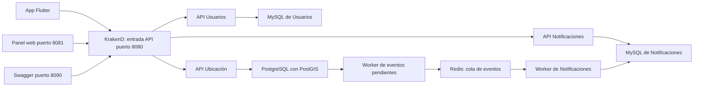

# Guía para explicar y demostrar los sprints 1 y 2

Estado comprobado localmente al 27 de octubre de 2026. Esta guía describe el conjunto del
proyecto: incluye la implementación que ya existía y las correcciones, ampliaciones y
verificaciones realizadas después. No atribuye todo el código a una sola persona.

## 1. Cómo presentar el objetivo

> ColcaTrufis está separando sus responsabilidades en tres servicios: Usuarios, Ubicación y
> Notificaciones. El sprint 1 dejó la base de esa arquitectura funcionando en local, con una
> entrada común y un mapa. El avance del sprint 2 permite editar recorridos, encontrar paradas
> cercanas y generar avisos por los cambios. Aún quedan validaciones y funcionalidades pendientes.

Un **monolito** reúne muchas funciones en una aplicación; el original está en `backend/`.
Los **microservicios** separan esas funciones en aplicaciones: están en `services/`.
Cada una tiene su propia base de datos. Esto permite trabajar en responsabilidades separadas,
pero exige coordinar la autenticación, los contratos y los mensajes entre servicios.
El monolito no se ha reemplazado por completo ni se han migrado sus datos reales.



## 2. Sprint 1: base de la arquitectura

### Docker y puesta en marcha

Docker ejecuta las aplicaciones y sus dependencias en contenedores. Compose coordina el
conjunto: Gateway, tres APIs, bases, Redis, workers, panel y Swagger. Los volúmenes conservan
los datos al detener los contenedores.

Se corrigieron las dependencias Composer incompatibles con el PHP de las imágenes, las
dependencias de PostgreSQL y el arranque de Laravel. Las imágenes actuales usan PHP 8.3.13;
no es necesario instalar Composer en Windows para levantar los servicios con Docker.

**Mostrar:** [`docker-compose.yml`](../docker-compose.yml) y, como ejemplo,
[`Dockerfile de Ubicación`](../services/api-ubicacion/Dockerfile).
`composer.json` declara paquetes y `composer.lock` fija sus versiones.

### API Gateway: KrakenD y la comparación con Kong

Un **API Gateway** es la puerta de entrada a las APIs. La app y el panel solicitan datos al
puerto 8080; KrakenD decide a qué servicio enviar cada petición y valida los tokens de las
rutas protegidas.

**Kong y KrakenD son productos alternativos para ese papel.** “Kong vs. KrakenD” es el título
de una decisión de arquitectura, no dos servicios que se estén ejecutando juntos.
El proyecto eligió **KrakenD 2.7.2 CE** por el ajuste a las necesidades de esta implementación:
configuración por archivos, validación JWT con clave pública y reenvío de identidad a los
servicios. No se hizo una prueba comparativa que demuestre que uno siempre es más rápido.

En esta configuración cada endpoint se declara explícitamente. Agregar un endpoint a Laravel
requiere agregarlo también al Gateway para que sea accesible a los clientes.

**Mostrar:** [decisión Kong/KrakenD](adr/0001-api-gateway.md),
[`gateway/krakend.tmpl`](../gateway/krakend.tmpl) y
[`gateway/settings/endpoints.json`](../gateway/settings/endpoints.json).

**Advertencia de lectura del ADR:** su último pendiente sobre endpoints administrativos es
histórico. Actualmente la edición se autoriza con el middleware de Ubicación descrito en el
ADR 0004; el Gateway valida el JWT y propaga la identidad y el rol.

### Usuarios y seguridad

La API de Usuarios registra cuentas, valida el login, devuelve el perfil y renueva la sesión.
Usa MySQL propio y emite **JWT**, credenciales firmadas que el cliente envía en
`Authorization: Bearer <token>`.

**RS256** es el algoritmo de firma: Usuarios firma con la clave privada y el Gateway comprueba
la firma con la pública. El token está firmado; su contenido no se considera cifrado.
Los **claims** son sus datos: `sub` identifica al usuario, `rol` indica su papel y `exp` su
vencimiento. El **refresh token** permite obtener una sesión renovada y rota al utilizarse:
el anterior deja de servir.

**Mostrar:** [endpoints de Usuarios](../services/api-usuarios/routes/api.php),
[`AuthController.php`](../services/api-usuarios/app/Http/Controllers/AuthController.php),
[`JwtService.php`](../services/api-usuarios/app/Services/JwtService.php) y
[migrador de usuarios](../services/api-usuarios/app/Console/Commands/MigrarUsuariosMonolito.php).

El migrador existe y tiene pruebas con datos simulados. Falta ejecutarlo con el monolito real.

### Ubicación, PostGIS y GeoJSON

La API de Ubicación guarda recorridos y paradas. **PostGIS** añade funciones geográficas a
PostgreSQL: permite guardar geometrías y consultar distancias.

- **LineString:** una secuencia de puntos que dibuja un recorrido.
- **Point:** la posición de una parada.
- **EPSG:4326:** referencia geográfica de coordenadas de longitud y latitud.
- **GeoJSON:** formato JSON para intercambiar geometrías con el mapa. Sus coordenadas usan
  el orden `[longitud, latitud]`.
- **FeatureCollection:** colección de elementos GeoJSON.
- **GiST:** tipo de índice usado para acelerar consultas espaciales.

Hay cuatro líneas cargadas desde OpenStreetMap: **201, 252, 270 y 290**, con **22 paradas**.
Se pueden consultar rutas, filtrarlas por línea/sindicato/estado y obtener detalles y paradas.
Estos datos geográficos de OSM aún requieren revisión municipal.

**Mostrar:** [controlador de rutas](../services/api-ubicacion/app/Http/Controllers/RutaController.php),
[migraciones de la base](../services/api-ubicacion/database/migrations),
[datos iniciales GeoJSON](../services/api-ubicacion/database/data/rutas_colcapirhua.geojson) y
[migrador de rutas del monolito](../services/api-ubicacion/app/Console/Commands/MigrarRutasMonolito.php).

### Notificaciones y comunicación entre servicios

El sprint 1 preparó una prueba de concepto: Ubicación publica el evento `ruta.actualizada`,
Redis lo deja en una cola y un worker de Notificaciones lo consume. Notificaciones busca a
quienes están suscritos a esa línea y guarda un aviso para cada uno en su MySQL.

Un **evento** describe algo ocurrido. Un **worker** es un proceso que trabaja en segundo plano.
La **cola** permite separar la publicación del procesamiento. El UUID identifica el evento;
registrar los ya procesados permite evitar avisos duplicados si se repite el mismo evento.

**Mostrar:** [decisión de comunicación](adr/0002-comunicacion-entre-servicios.md),
[ejemplo de evento](eventos/ruta.actualizada.json),
[`ProcesadorEventos.php`](../services/api-notificaciones/app/Services/ProcesadorEventos.php) y
[endpoints de suscripciones y avisos](../services/api-notificaciones/routes/api.php).

**Alcance:** los avisos se guardan y consultan por API. Todavía no son notificaciones push al teléfono.

### Flutter y panel web

Flutter cuenta con login, almacenamiento de tokens, un cliente HTTP común y renovación de
sesión. El mapa usa MapLibre para dibujar rutas con colores y mostrar información al tocarlas.
OpenFreeMap aporta el mapa base; PostGIS aporta las rutas y paradas de esta aplicación.

Los **mocks** son respuestas de prueba para trabajar sin las APIs reales. Se generaron fixtures
con las cuatro rutas y 22 paradas y se probaron sus relaciones y filtros.

**Mostrar en Flutter:**
[cliente de red](../fronted/lib/core/network/gateway_client.dart),
[almacenamiento de tokens](../fronted/lib/core/auth/token_storage.dart),
[login](../fronted/lib/features/login/login_screen.dart),
[mapa](../fronted/lib/features/mapa/mapa_rutas_screen.dart) y
[mocks](../fronted/assets/mocks).

El panel web permite acceder como admin/encargado, ver el mapa, activar y ocultar rutas/paradas
y consultar detalles. Se corrigió el CORS duplicado que bloqueaba la conexión del navegador
al Gateway. **CORS** es el mecanismo del navegador que controla las peticiones entre orígenes,
por ejemplo entre el panel en 8081 y la API en 8080.

**Mostrar:** [panel en el navegador](http://localhost:8081),
[`admin-web/index.html`](../admin-web/index.html) y [`admin-web/app.js`](../admin-web/app.js).

### Contratos, pruebas, rendimiento y trabajo en equipo

**OpenAPI** describe las peticiones y respuestas de las APIs; **Swagger UI** permite verlas y
ejecutarlas. Se corrigieron errores de los contratos y se comprobó su uso desde Chrome.

**CI** significa integración continua: un workflow de GitHub Actions prepara tests, validación
de contratos, formato, compilación Flutter e integración con Docker. El archivo está preparado;
falta publicar estos cambios y comprobar su ejecución remota. La protección real de `main`
también requiere la intervención del propietario con permisos de administrador.

Un **ADR** documenta una decisión técnica y su motivo. El proyecto contiene decisiones sobre
Gateway, eventos y organización del repositorio. El **monorepo** reúne componentes en un mismo
repositorio. Un **PR** es la propuesta de cambios que otro integrante puede revisar.

Se aislaron los tests de las bases de desarrollo. Ubicación se verifica contra PostGIS de prueba;
Usuarios y Notificaciones usan SQLite en memoria durante sus tests.

**Mostrar:** [Swagger](http://localhost:8090), [contratos](openapi),
[workflow](../.github/workflows/ci.yml), [evidencias QA](qa-sprint-1.md) y
[estrategia de ramas](adr/0003-repositorio-y-ramas.md).

**k6** genera carga para medir tiempos y errores. Los scripts están preparados y se ejecutó una
prueba corta parcial sobre microservicios. Falta la **línea base del monolito**: medir el sistema
anterior con sus datos reales y las mismas condiciones. Sin ella no se puede demostrar una mejora
de rendimiento por cambiar de arquitectura.

**Mostrar:** [`perf/README.md`](../perf/README.md) y [resultados](../perf/resultados).

## 3. Sprint 2: avance funcional

### Paradas cercanas

`GET /api/ubicacion/paradas/cercanas` recibe latitud, longitud, radio y límite. PostGIS calcula
distancias en metros y devuelve las paradas ordenadas por cercanía. El panel permite seleccionar
un punto y buscar a 300 metros. Es proximidad geográfica, no distancia caminando por calles.

**Mostrar:** [método `cercanas`](../services/api-ubicacion/app/Http/Controllers/ParadaController.php),
[nuevo índice espacial](../services/api-ubicacion/database/migrations/2026_10_27_000001_create_eventos_salida_table.php)
y sección **Paradas cercanas** del panel.

### Edición visual y permisos

`PUT /api/ubicacion/rutas/{id}` permite editar recorridos. En el panel un admin puede arrastrar,
añadir, quitar y restablecer puntos, cambiar nombre/estado/color y guardar un motivo.
La API también valida los datos y el rol; ocultar el botón no es el único control de acceso.
Una prueba comprueba que un usuario normal no consigue permisos enviando headers falsos.

El seeder ahora agrega rutas faltantes sin sobrescribir los cambios del administrador al reiniciar.
Un **seeder** es el código que carga los datos iniciales.

**Mostrar:** [método `update`](../services/api-ubicacion/app/Http/Controllers/RutaController.php),
[middleware de admin](../services/api-ubicacion/app/Http/Middleware/AdministradorDelGateway.php),
[editor web](../admin-web/app.js),
[seeder](../services/api-ubicacion/database/seeders/DatabaseSeeder.php) y
[pruebas de edición](../services/api-ubicacion/tests/Feature/EdicionRutaTest.php).

### Cambio de ruta y evento persistente

La edición guarda el recorrido y su evento en una misma **transacción**: ambos se guardan o
se revierte el conjunto. El evento queda en `eventos_salida`. Un worker lo envía a Redis y
reintenta si Redis falla. Este patrón se llama **outbox**, una bandeja de salida persistente.

Flujo: guardar ruta → guardar evento pendiente → worker → Redis → worker de Notificaciones →
aviso para cada suscriptor. El sprint 1 demostró el mensaje de prueba; el sprint 2 lo conectó
al guardado real de una ruta y añadió persistencia y reintentos del productor.

**Mostrar:** [ADR 0004](adr/0004-edicion-rutas-y-eventos.md),
[`DespachadorEventos.php`](../services/api-ubicacion/app/Services/DespachadorEventos.php),
[comando worker](../services/api-ubicacion/app/Console/Commands/DespacharEventos.php) y servicio
`worker-eventos-ubicacion` en Compose.

El consumidor actual todavía retira el mensaje con `BRPOP` antes de guardarlo. Si cae justo
en ese intervalo puede perderlo; no hay garantía completa de entrega de extremo a extremo.
FCM, confirmaciones de consumo y cola de fallidos siguen pendientes.

## 4. Demostración sugerida de 10 a 15 minutos

### Preparar

Con Docker Desktop abierto, en la raíz del proyecto:

```powershell
docker compose up --build
```

Espera el arranque. Usa otra terminal para `docker compose ps`: las APIs y bases deben aparecer
en ejecución y saludables. La terminal principal seguirá mostrando logs mientras está encendido.
Los cambios de código de los servicios necesitan reconstrucción de las imágenes.

Para detener la ejecución iniciada así, usa `Ctrl+C` y comprueba el estado. Si necesitas detener
el conjunto restante, ejecuta `docker compose stop`. Ambos conservan las bases de datos.

### Recorrido

1. **Arquitectura:** abre Compose y explica las tres APIs con sus bases y el Gateway común.
2. **Panel, sprint 1:** abre http://localhost:8081. Entra con
   `admin@colcatrufis.local` / `admin12345`. Muestra las cuatro líneas, sus colores, paradas,
   filtros y detalles al hacer clic. El mapa base requiere Internet.
3. **Seguridad y APIs:** abre http://localhost:8090. Selecciona API de Usuarios, despliega
   `POST /api/usuarios/login`, pulsa **Try it out**, usa las credenciales de desarrollo y
   ejecuta. Copia solo el valor de `access_token`, sin comillas.
4. Cambia a API de Ubicación, pulsa **Authorize** y pega el token en `bearerAuth`.
   Ejecuta `GET /api/ubicacion/rutas`: muestra el `200` y `FeatureCollection`.
   Quita la autorización y repite: el `401` demuestra que exige autenticación.
   Autoriza de nuevo para continuar. La autorización puede requerirse otra vez al cambiar API.
5. **Cercanía, sprint 2:** en el panel pulsa **Elegir ubicación en el mapa** y selecciona un
   punto próximo a una parada. Muestra la lista con distancias; un punto alejado puede devolver cero.
6. **Editor, sprint 2:** selecciona una ruta y pulsa **Editar trazado**. Arrastra un punto,
   restablece y cancela para mostrar los controles sin dejar cambios. Para demostrar el guardado,
   vuelve al editor, conserva el trazado, introduce un motivo como “Demostración de guardado”
   y pulsa **Guardar cambio**. Se guarda y se genera un evento aunque conserves la geometría.
7. **Aviso entre servicios:** antes del guardado, puedes suscribirte como admin desde Swagger,
   API de Notificaciones, `POST /api/notificaciones/suscripciones`, con `{"linea":"252"}`.
   Autoriza con el token admin. Guarda esa misma línea en el panel y después consulta
   `GET /api/notificaciones` en Swagger: debe aparecer el aviso del cambio.
   La demostración crea una suscripción y un aviso de desarrollo.
8. **Restricción de rol:** sal del panel e intenta entrar con
   `demo@colcatrufis.local` / `demo12345`: el rol usuario no entra al panel administrativo.
   Esa cuenta sí puede usar las APIs permitidas y la app.
9. **Flutter:** muestra los archivos de login, red y mapa. Si deseas ejecutarlo en Chrome:

   ```powershell
   cd fronted
   flutter pub get
   flutter run -d chrome --dart-define=GATEWAY_URL=http://localhost:8080
   ```

   Las pruebas locales y compilación web no sustituyen la prueba pendiente en Android físico.
10. **Evidencia:** abre `docs/qa-sprint-1.md` y las capturas de `docs/qa/artifacts/`. Finaliza
    mostrando los pendientes, para distinguir lo demostrado de lo planificado.

## 5. Qué pruebas se ejecutaron y qué falta

| Evidencia local | Resultado registrado |
|---|---|
| PHP: Usuarios / Ubicación / Notificaciones | 11 / 17 / 5: total 33 casos |
| Flutter: red, sesión y mocks | 6 casos |
| Integración por Gateway, seguridad y eventos | 40 comprobaciones |
| Chrome: panel, edición, roles y Swagger | 15 comprobaciones |
| Copia de fuentes sin dependencias y bases nuevas | Correcta; 97.99 s de arranque con caché Docker existente |

Los casos de Ubicación incluyen 6 originales y 11 nuevos del avance del sprint 2. No se deben
sumar todos estos resultados como si fueran pruebas exclusivas del sprint 1.

Para repetir la comprobación integrada desde la raíz:

```powershell
powershell -ExecutionPolicy Bypass -File scripts/smoke-test.ps1 -Sprint2
```

La política Bypass se aplica a ese proceso de PowerShell. El smoke crea avisos de desarrollo y
guarda el mismo trazado para comprobar la edición. No hace falta volver a ejecutar todas las
pruebas durante la exposición: se pueden mostrar las evidencias ya registradas.

**Sprint 1: falta cerrar formalmente** la migración con la base real, línea base del monolito,
prueba Android y regresión clásica, validación municipal de trazados, aprobaciones del equipo,
protección de `main` y ejecución remota del CI. El arranque con descarga fría tampoco se ha
demostrado con el tiempo objetivo; la verificación limpia usó caché existente.

**Sprint 2: es un avance.** Faltan push con FCM (Firebase Cloud Messaging), registro de
dispositivos, interfaz móvil de suscripciones, desuscripción e historial filtrado, radiotaxis
reales y sus capas/actualizaciones, logout con revocación y administración ampliada de usuarios,
además de nuevas rutas y revisión del equipo. Ver el alcance en [sprint 2](sprint-2.md).

## 6. Qué se corrigió o amplió durante esta asistencia

La estructura de tres APIs, KrakenD, JWT, mapas y comandos de migración ya estaba presente.
Se corrigió el arranque Docker/Composer, el CORS del navegador y la comunicación Redis;
se agregaron mocks verificables, correcciones de Swagger, aislamiento de tests y evidencias
reproducibles. Se amplió CI y se implementó el avance de cercanía, editor administrativo,
eventos persistentes y conservación de ediciones. Estos cambios están en el árbol de trabajo
local; no equivalen a un despliegue público ni a un CI remoto aprobado.
