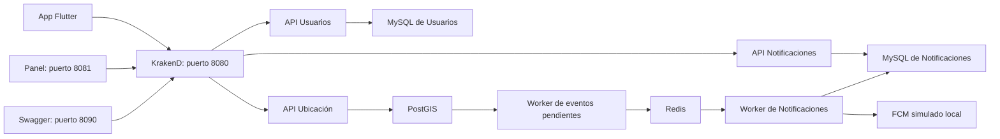

# Guía para explicar y demostrar los sprints 1 y 2

Estado comprobado localmente al **3 de noviembre de 2026**, en Windows con Docker Desktop.
Esta guía describe el conjunto del proyecto: incluye código que ya existía y correcciones,
ampliaciones y pruebas posteriores. No atribuye toda la implementación a una sola persona.
El detalle para marcar tareas está en [avance del 03/11](avance-sprints-2026-11-03.md),
[Sprint 1](sprint-1.md) y [Sprint 2](sprint-2.md).

## 1. Cómo presentar el objetivo

> ColcaTrufis separa Usuarios, Ubicación y Notificaciones en tres servicios con un Gateway común.
> El sprint 1 aporta la arquitectura, la autenticación y el mapa. El sprint 2 añade edición de
> rutas, paradas cercanas, radio taxis, suscripciones y avisos. El funcionamiento local está
> probado; faltan la migración real, Android físico y las validaciones externas.

El **monolito** original está en `backend/`; reúne las responsabilidades en una aplicación.
Los **microservicios** están en `services/` y tienen bases separadas. El monolito no se ha
reemplazado por completo y no se migraron sus usuarios ni sus rutas reales.



## 2. Qué explicar del sprint 1

**Docker y Gateway.** Compose levanta las APIs, sus bases, Redis, workers, panel, Swagger y
FCM simulado. KrakenD 2.7.2 recibe las solicitudes en el puerto 8080, valida el JWT y enruta
cada endpoint. Kong fue una alternativa evaluada en el [ADR 0001](adr/0001-api-gateway.md);
no se ejecutan ambos productos. Los endpoints deben existir en Laravel y en
[`gateway/settings/endpoints.json`](../gateway/settings/endpoints.json).

**Usuarios.** El servicio firma JWT con RS256: usa su clave privada y el Gateway comprueba
la firma con la pública. `sub` identifica al usuario, `rol` indica su papel y `exp` su vencimiento.
El cliente envía `Authorization: Bearer <token>`. El refresh token rota y se consume una sola
vez, incluso ante solicitudes simultáneas. En la prueba real por Gateway/MySQL una recibió
200 y la otra 401; después del logout el refresh revocado recibió 401.

**Geografía.** PostGIS añade funciones espaciales a PostgreSQL. Un `LineString` representa
un recorrido y un `Point`, una parada. GeoJSON intercambia esas geometrías usando
`[longitud, latitud]` en EPSG:4326. Los índices GiST ayudan en las consultas espaciales.
La semilla actual contiene **22 rutas y 135 paradas de OpenStreetMap**; se comprobaron cero
geometrías inválidas. Esto no equivale a aprobar los trazados con el municipio ni en geojson.io.

**Clientes y contratos.** Flutter usa un cliente común, almacenamiento seguro de tokens y
MapLibre para el mapa. Las fixtures actuales contienen las mismas 22 rutas y 135 paradas.
El panel admite admin/encargado y rechaza el rol usuario. OpenAPI describe los contratos y
Swagger permite probarlos desde el navegador. La comprobación de hoy ejecutó un endpoint
protegido de cada una de las tres APIs desde Swagger.

Archivos para mostrar: [`docker-compose.yml`](../docker-compose.yml),
[`JwtService.php`](../services/api-usuarios/app/Services/JwtService.php),
[controlador de rutas](../services/api-ubicacion/app/Http/Controllers/RutaController.php),
[cliente Flutter](../fronted/lib/core/network/gateway_client.dart),
[panel](../admin-web/app.js) y [contratos](openapi).

## 3. Qué explicar del sprint 2

**Cercanía y edición.** `GET /api/ubicacion/paradas/cercanas` devuelve paradas ordenadas por
distancia en metros; es proximidad geográfica, no distancia caminando. Un administrador puede
editar puntos, propiedades y motivo de una ruta con `PUT /api/ubicacion/rutas/{id}`. La API
valida el rol: enviar cabeceras falsas no concede permisos. El seeder agrega datos faltantes
sin sobrescribir las ediciones guardadas.

**Eventos y push.** La edición guarda ruta y evento juntos en una transacción. El evento queda
en `eventos_salida`; un worker lo publica en Redis y reintenta si falla. Esta bandeja de salida
se llama **outbox**. Notificaciones guarda un aviso por suscriptor y evita duplicados mediante
el UUID del evento. El worker envía los push pendientes y reintenta fallos; solo elimina un
dispositivo cuando FCM indica `UNREGISTERED`, no por un 404 genérico.

El flujo completo editar → outbox → Redis → aviso → FCM está probado **con `fcm-mock`**.
La integración móvil y la pantalla de suscripciones están implementadas y sus tests pasan;
la entrega real necesita un proyecto Firebase y un teléfono. El consumidor aún usa `BRPOP`:
si cae después de retirar un evento y antes de guardarlo puede perderlo. El
[ADR 0002](adr/0002-comunicacion-entre-servicios.md) describe esa limitación.

**Radio taxis y usuarios.** API, panel y app incluyen la capa de radio taxis con consulta cada
30 segundos. Sus datos y movimiento locales son de demostración; no proceden de GPS real.
El panel permite listar usuarios solo al administrador. También existen perfil por ID,
logout con revocación del refresh, suscripción/desuscripción e historial filtrado.

Archivos para mostrar: [edición y eventos](adr/0004-edicion-rutas-y-eventos.md),
[FCM y datos de radio taxis](adr/0005-push-fcm-y-radiotaxis.md),
[endpoints de Usuarios](../services/api-usuarios/routes/api.php),
[endpoints de Notificaciones](../services/api-notificaciones/routes/api.php) y
[configuración móvil](../fronted/README.md).

## 4. Demostración sugerida de 10 a 15 minutos

Con Docker Desktop abierto, desde la raíz del proyecto:

```powershell
docker compose up -d --build --wait --wait-timeout 300
docker compose ps
```

Las APIs y bases deben aparecer saludables. Los volúmenes conservan los datos. Para detener
el entorno conservándolos: `docker compose stop`. Los cambios del backend requieren reconstruir
las imágenes.

1. Abre http://localhost:8081 y entra con `admin@colcatrufis.local` / `admin12345`.
   Muestra rutas, paradas, colores, filtros y detalles. El mapa base requiere Internet.
2. Busca paradas cercanas seleccionando un punto del mapa. Edita una ruta, arrastra un punto,
   restablece y cancela. Para demostrar el guardado, conserva el trazado, introduce un motivo
   y guarda: se genera un evento aunque no cambies la geometría.
3. Abre http://localhost:8090, selecciona Usuarios y ejecuta `POST /api/usuarios/login`.
   Copia solo el `access_token`, sin comillas. En cada API usa **Authorize** para pegarlo.
   Ejecuta `GET /api/usuarios/lista`, `GET /api/ubicacion/rutas` y
   `GET /api/notificaciones/historial`. Quita la autorización y comprueba el 401.
4. Para mostrar el aviso entre servicios, suscríbete a la línea 252 con
   `POST /api/notificaciones/suscripciones`, cuerpo `{"linea":"252"}`. Guarda esa misma
   ruta en el panel y consulta `GET /api/notificaciones`: debe aparecer el aviso.
   Esto crea una suscripción y un aviso de desarrollo.
5. Muestra la lista de usuarios como admin. Sal e intenta entrar con
   `demo@colcatrufis.local` / `demo12345`: el rol usuario no entra al panel.
6. Si quieres mostrar movimiento simulado de radio taxis, ejecuta:

   ```powershell
   docker compose --profile demo up -d
   ```

   Activa su capa y espera la actualización de 30 segundos. Explica que son datos de demostración.
7. Muestra el código y los resultados de Flutter. Para ejecutarlo en Chrome con Flutter instalado:

   ```powershell
   Set-Location fronted
   flutter pub get
   flutter run -d chrome --dart-define=GATEWAY_URL=http://localhost:8080
   ```

   En Android físico se usa la IP de la PC y la configuración de red descrita en
   [`fronted/README.md`](../fronted/README.md). Las pruebas automáticas no sustituyen esa prueba.
8. Abre [QA del sprint 2](qa-sprint-2.md) y el [avance del 03/11](avance-sprints-2026-11-03.md)
   para mostrar qué se verificó y qué queda pendiente.

## 5. Evidencia disponible y tareas que quedan abiertas

Resultados del 03/11/2026 en Windows/Docker:

| Comprobación | Resultado |
|---|---|
| PHPUnit: Usuarios / Ubicación / Notificaciones | 22 / 25 / 24: **71 casos** |
| Flutter: suite completa | **20 tests aprobados** |
| Flutter web release y APK debug ARM64 | Compilaciones aprobadas; prueba física y Firebase pendientes |
| PowerShell: `scripts/smoke-test.ps1 -Sprint2` | **59 comprobaciones**, dos ejecuciones correctas |
| Chrome: panel y Swagger de las tres APIs | **23 comprobaciones** y capturas actualizadas |
| PostGIS | 22 rutas, 135 paradas, 0 geometrías inválidas |
| Refresh simultáneo real, Gateway/MySQL | 200 + 401; logout 204 y refresh revocado 401 |
| Arranque Docker | Construcción con caché, volúmenes existentes conservados |
| Copia de fuentes limpias y bases nuevas | 80,52 s con caché; 71 tests y 59 comprobaciones, semilla intacta y limpieza correcta |

Para repetir la integración desde la raíz:

```powershell
powershell -ExecutionPolicy Bypass -File scripts/smoke-test.ps1 -Sprint2
node scripts/browser-qa.mjs
```

El smoke registra avisos y guarda el mismo trazado para comprobar el flujo. El navegador usa
un perfil temporal. Los tests de Usuarios/Notificaciones usan SQLite en memoria; Ubicación
usa PostGIS de pruebas. La copia limpia de hoy utilizó otro proyecto Docker, bases nuevas y
puertos libres, incluido FCM; [resultado](qa/artifacts/clean-verify.json). No fue un clon remoto
ni una descarga fría.

La **línea base k6 del monolito ya existe** en [`perf/README.md`](../perf/README.md), con esquema
real y semilla OSM comparable. No usa datos de producción y no se volvió a medir hoy en Windows.
Sus cifras previas en Mac no deben mezclarse con mediciones en otro equipo.

El **CI remoto de la base ya está aprobado**: la
[ejecución 41564765479](https://github.com/GeraldVargas/proyectotelematicos/actions/runs/41564765479)
corresponde al commit `e9e9bf91589b517a70926133b21b57f94df1f58e`, que coincide con el HEAD
local consultado. Fue creada el **02/11/2026 a las 22:13 (Bolivia)** y sus siete jobs terminaron
correctamente: tests/Pint de tres APIs, contratos, panel, Flutter e integración Docker con k6.
Las correcciones y documentos locales del 03/11 aún no están publicados; su propia ejecución
remota sigue pendiente. Las pruebas locales de hoy se documentan por separado.

Permanecen abiertos: migración manual de datos reales; Android físico y regresión clásica;
Firebase y push real; comprobación en geojson.io y revisión municipal; firmas del equipo;
protección de `main` con una cuenta administradora; publicación y CI de los cambios locales
del 03/11. Estos pendientes impiden declarar ambos sprints cerrados formalmente.

## 6. Cómo atribuir los cambios

La arquitectura de tres APIs, JWT, mapas, migradores y gran parte de las funciones del sprint 2
ya estaban en el proyecto. Las sesiones de asistencia corrigieron arranque, CORS, comunicación,
aislación de pruebas y contratos, ampliaron funciones y dejaron evidencia reproducible.
En la revisión del 03/11 se corrigió la reutilización concurrente del refresh y el borrado de
dispositivos por 404 genéricos; además se volvió a comprobar el conjunto en Windows.
Los archivos locales y las pruebas no implican publicación ni despliegue público.
