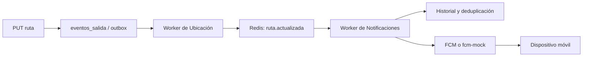

# API de Notificaciones y arquitectura de eventos

## Flujo de eventos

Una edición de ruta guarda la geometría y el evento `ruta.actualizada` en una misma transacción.
El patrón outbox evita que se confirme un cambio sin registrar el aviso pendiente. Un worker publica
el evento en Redis y el servicio de Notificaciones lo consume, guarda el historial por suscriptor
y entrega el push mediante FCM o el mock local.

## Endpoints

| Método | Endpoint | Propósito |
|---|---|---|
| GET | `/api/notificaciones` | Avisos del usuario autenticado, paginados. |
| GET | `/api/notificaciones/suscripciones` | Líneas suscritas. |
| POST | `/api/notificaciones/suscripciones` | Suscribirse a una línea. |
| DELETE | `/api/notificaciones/suscripciones/{lineaId}` | Eliminar una suscripción. |
| GET | `/api/notificaciones/historial` | Historial con filtros de fecha y paginación. |
| POST | `/api/notificaciones/dispositivos` | Registrar el token del dispositivo. |
| DELETE | `/api/notificaciones/dispositivos` | Retirar el token del dispositivo. |

El formato de `ruta.actualizada` está en
[`ruta.actualizada.json`](../eventos/ruta.actualizada.json) y el contrato en
[`notificaciones.yaml`](../openapi/notificaciones.yaml). Se verificaron 24 pruebas del servicio y
el flujo llega a `fcm-mock`. La entrega a Firebase y a un teléfono físico permanece pendiente.
