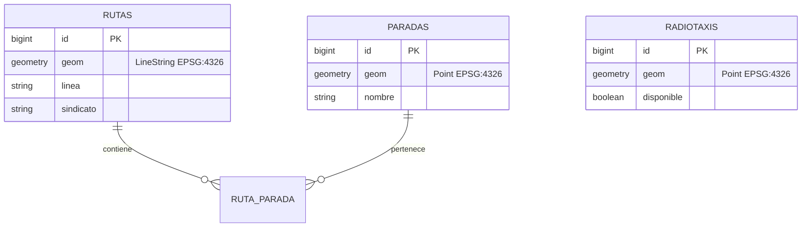

# API de Ubicación y mapas vectoriales

## Modelo geográfico

El servicio usa PostGIS con EPSG:4326. Cada ruta es un `LineString`, cada parada y radio taxi es
un `Point`, y las respuestas se exponen como GeoJSON RFC 7946. Las geometrías disponen de índices
GiST; la línea de trufi posee además un índice B-tree para los filtros de línea.

## Endpoints principales

| Método | Endpoint | Propósito |
|---|---|---|
| GET | `/api/ubicacion/rutas` | Rutas GeoJSON; permite filtros por línea, sindicato y estado. |
| GET | `/api/ubicacion/rutas/{id}` | Detalle de una ruta y sus paradas. |
| PUT | `/api/ubicacion/rutas/{id}` | Editar trazado; solo administrador; genera `ruta.actualizada`. |
| GET | `/api/ubicacion/paradas` | Paradas GeoJSON. |
| GET | `/api/ubicacion/paradas/cercanas` | Paradas ordenadas por distancia mediante `ST_DWithin`. |
| GET | `/api/ubicacion/radiotaxis` | Radio taxis disponibles como GeoJSON. |
| PUT | `/api/ubicacion/radiotaxis/{id}/posicion` | Actualizar posición; solo administrador. |

La semilla de demostración validada contiene 22 rutas, 10 723 puntos de trazado y 135 paradas.
El contrato completo está en [`ubicacion.yaml`](../openapi/ubicacion.yaml).

## Evidencia visual pendiente

Existe una captura del panel con el mapa en
[`panel-mapa.png`](../qa/artifacts/panel-mapa.png). Para cerrar por completo la tarea del Sprint 3
falta pegar el GeoJSON en geojson.io y guardar una captura de esa revisión manual; no se debe
declarar esa parte como realizada hasta entonces.
