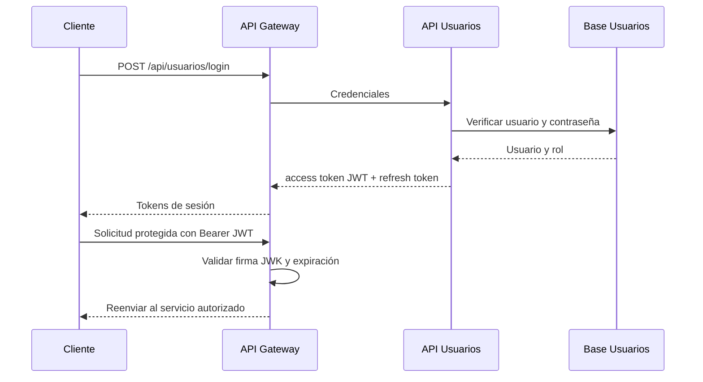

# API de Usuarios

## Decisiones de diseño

La autenticación se separó en el servicio `api-usuarios`. El servicio emite JWT firmados con
RS256; el Gateway valida la firma mediante la clave pública JWK antes de enviar una solicitud a
los servicios protegidos. El token contiene la identidad (`sub`) y el rol (`rol`) necesarios para
autorizar las operaciones.

Los refresh tokens se almacenan por separado y se rotan al renovar una sesión. La rotación es
atómica: dos solicitudes simultáneas no pueden consumir el mismo refresh token. Al cerrar sesión,
el refresh queda revocado.

## Secuencia de inicio de sesión

## Endpoints

| Método | Endpoint | Propósito |
|---|---|---|
| POST | `/api/usuarios/registro` | Registrar una cuenta. |
| POST | `/api/usuarios/login` | Autenticar y emitir tokens. |
| POST | `/api/usuarios/refresh` | Rotar el refresh y emitir un access token nuevo. |
| GET | `/api/usuarios/perfil` | Consultar el perfil del usuario autenticado. |
| GET | `/api/usuarios/perfil/{id}` | Consultar un perfil por identificador. |
| GET | `/api/usuarios/lista` | Listar usuarios con paginación; solo administrador. |
| DELETE | `/api/usuarios/sesion` | Revocar la sesión actual. |

El contrato completo, incluidos ejemplos de request y response, está en
[`usuarios.yaml`](../openapi/usuarios.yaml). La suite verificada contiene 22 casos para este
servicio; la migración de usuarios reales del monolito continúa pendiente de recibir un respaldo.
