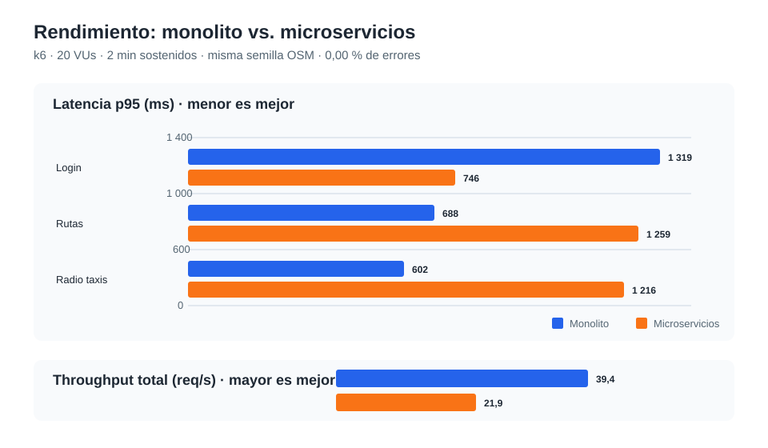

# Sprint 3 — rendimiento y preparación de entrega

Ver también la [revisión de realizados del 10/11](revision-realizados-2026-11-10.md):
contraste de las evidencias, pruebas locales ejecutadas y corrección del panel.

## Objetivo

Comparar el monolito y la arquitectura de microservicios con la misma semilla OSM y un perfil de
carga reproducible. El alcance de este sprint es el análisis de rendimiento; las validaciones en
Android físico, Firebase real, firmas y protección remota de la rama se conservan como pendientes
externos de los sprints anteriores.

## Método

Las dos corridas se ejecutaron el 02/11/2026 en un Apple M4, 16 GB, usando la red interna de
Docker/Colima, la misma semilla (22 rutas, 10 723 puntos y 4 radio taxis), 20 VUs durante 2 min,
rampa de 20 s y bajada de 10 s. El reparto fue 4 VUs para login, 12 para rutas y 4 para radio
taxis. El detalle reproducible está en [perf/README.md](../perf/README.md).

| Métrica | Monolito | Microservicios | Variación microservicios |
|---|---:|---:|---:|
| Login p50 / p95 | 1 072 / 1 319 ms | 597 / 746 ms | -44 % / -43 % |
| Rutas p50 / p95 | 480 / 688 ms | 1 001 / 1 259 ms | +109 % / +83 % |
| Radio taxis p50 / p95 | 411 / 602 ms | 977 / 1 216 ms | +138 % / +102 % |
| Throughput | 39,4 req/s | 21,9 req/s | -44 % |
| Errores HTTP | 0,00 % | 0,00 % | sin regresión |

Evidencias: [monolito](../perf/resultados/monolito-2026-11-03T00-40-18-619Z.md) y
[microservicios](../perf/resultados/microservicios-2026-11-03T00-43-52-600Z.md).

La gráfica separa latencia p95 (menos es mejor) de throughput (más es mejor), para no mezclar
milisegundos y solicitudes por segundo en la misma escala.

## Conclusiones

- **RNF5 superado para este perfil:** p95 de rutas es menor a 2 s en ambas arquitecturas; los
  microservicios quedan en 1 259 ms y no registran errores.
- **Login mejora en microservicios:** el JWT del Gateway completa el flujo más rápido que el login
  de formulario con CSRF y sesión del monolito. No es una equivalencia exacta: el flujo del
  monolito hace dos peticiones.
- **Las lecturas GIS empeoran, pero siguen dentro del objetivo:** Gateway, JWT y PostGIS añaden
  coste. Además, PostGIS amd64 se ejecutó emulado en el Apple M4, por lo que no debe atribuirse toda
  la diferencia únicamente a la arquitectura.
- **No hay evidencia aún para RNF6 (100 usuarios concurrentes):** estas corridas miden 20 VUs.
  No se debe declarar ese requisito como cumplido hasta repetir la carga con 100 VUs y medir los
  mismos umbrales.

## Próximos pasos medibles

1. Repetir ambos objetivos en el mismo equipo x86 con 20 VUs para eliminar la emulación de PostGIS.
2. Ejecutar 100 VUs, conservando proporción 20 % login / 60 % rutas / 20 % radio taxis, y aceptar
   solo si rutas p95 < 2 s y errores < 1 %.
3. Perfilar `GET /api/ubicacion/rutas` y `GET /api/ubicacion/radiotaxis` antes de optimizar:
   confirmar uso de índices PostGIS, tamaño del GeoJSON y tiempos de Gateway.
4. Incorporar los nuevos informes en `perf/resultados/` y actualizar esta tabla con la fecha,
   hardware y configuración exactos.

## Estado

El análisis comparativo del Sprint 3 está documentado. La validación de 100 usuarios, el Android
físico, Firebase real, las firmas y la protección de `main` permanecen pendientes de recursos o
acciones externas.

## Verificación documental sin Docker — 10/11/2026

En una PC Windows donde Docker Desktop no estaba disponible se comprobó, sin ejecutar cargas, que:

- `perf/run.sh` no tiene errores de sintaxis.
- Los Compose del monolito y de los microservicios son válidos (`docker compose config -q`).
- Los dos informes de la comparación usan el mismo perfil: 20 VUs, 2 min sostenidos, rampa de
  20 s, bajada de 10 s y reparto 4/12/4 para login/rutas/radio taxis.
- Los resultados registrados son coherentes con RNF5: p95 de rutas de 688 ms (monolito) y
  1 259 ms (microservicios), con 0,00 % de errores en ambos casos.
- El escenario admite `VUS=100` y contiene los umbrales de rutas p95 menor a 2 s y errores
  menores al 1 %, pero esa carga **no se ejecutó** sin Docker/k6.
- Las 21 rutas declaradas por el Gateway están documentadas en OpenAPI y tienen su ruta
  correspondiente en los servicios de Usuarios, Ubicación o Notificaciones.
- Se revisaron 31 documentos Markdown y no tienen enlaces internos rotos.
- Los 117 archivos PHP de los tres servicios y el JavaScript del panel pasaron la validación de
  sintaxis; tampoco contienen marcadores técnicos pendientes (`TODO`, `FIXME`, `XXX`, `HACK` o
  `BUG`).
- El contrato de Usuarios contiene los siete endpoints previstos, ejemplos completos en sus cuatro
  solicitudes con cuerpo y ejemplos de respuesta en sus siete operaciones exitosas.

Esta revisión permite declarar realizados el perfil reproducible, la documentación y el análisis
comparativo de 20 VUs. No sustituye una nueva medición ni demuestra RNF6 (100 usuarios
concurrentes).

## Perfil previo a optimización sin Docker — 10/11/2026

La revisión estática deja preparada la optimización posterior, pero no reemplaza un perfilador en
ejecución ni `EXPLAIN ANALYZE` sobre PostGIS:

| Elemento | Hallazgo | Implicación |
|---|---|---|
| `GET /api/ubicacion/rutas` | `rutas.geom` tiene índice GiST y `linea` índice B-tree. La consulta convierte todas las geometrías con `ST_AsGeoJSON` y devuelve la colección completa. | El índice espacial no participa en un listado completo; la principal variable a medir es la serialización y el tamaño de respuesta. |
| Datos de rutas | La semilla GeoJSON ocupa 306 659 bytes y contiene las 22 rutas usadas en las pruebas. | Es un volumen pequeño para la demostración; no representa aún datos de producción. |
| `GET /api/ubicacion/radiotaxis` | `radiotaxis.geom` tiene índice GiST. La consulta filtra por `disponible`, ordena por ID y serializa puntos GeoJSON. | Con cuatro radio taxis demo no se justifica optimizar a ciegas. Si crece el volumen, medir un índice sobre `disponible` o uno parcial antes de añadirlo. |
| Gateway | La configuración enruta ambos endpoints directamente al servicio de Ubicación. | El coste real del Gateway solo puede medirse con el entorno levantado. |

Por tanto, el diagnóstico de código y datos queda realizado. Para declarar una optimización de
rendimiento realizada faltan las mediciones de tiempos del Gateway/PostGIS y, si procede, un cambio
respaldado por una nueva corrida k6.

La semilla se verificó además mediante análisis local: es una `FeatureCollection` válida con 22
`LineString`, 10 723 puntos y cero coordenadas fuera de los rangos geográficos. Esta validación no
ejecuta PostGIS ni sustituye las comprobaciones de geometrías almacenadas en la base de datos.

## Tabla para trasladar al informe

El PDF de planificación solo contiene tablas de Sprint 1 y Sprint 2. Para registrar Sprint 3,
agregar estas filas con el estado indicado:

| Tarea de Sprint 3 | Estado que se debe poner | Evidencia |
|---|---|---|
| Línea base y comparación monolito–microservicios con semilla OSM | **Realizado** | Dos corridas comparables de 20 VUs; informes en `perf/resultados/`. |
| Cuadro comparativo, gráfica y conclusiones de rendimiento | **Realizado** | Tabla y porcentajes contrastados contra los resultados k6. |
| RNF5: rutas con p95 menor a 2 s | **Realizado para el perfil de 20 VUs** | Monolito: 688 ms; microservicios: 1 259 ms; 0,00 % de errores. |
| Validación de la semilla OSM para rendimiento | **Realizado** | 22 rutas, 10 723 puntos y cero coordenadas inválidas. |
| Perfil previo a optimización de rutas y radio taxis | **Realizado documentalmente** | Índices, tamaño de datos, serialización y trayecto del Gateway revisados. |
| Repetir la comparación en PC x86 | **Pendiente: requiere Docker/k6** | No se levantaron contenedores en esta PC. |
| Validar 100 usuarios concurrentes (RNF6) | **Pendiente: requiere Docker/k6** | El escenario admite `VUS=100`, pero no se ejecutó. |
| Medir Gateway y PostGIS con perfilador/`EXPLAIN ANALYZE` | **Pendiente: requiere Docker/PostGIS activo** | La revisión actual fue estática. |
